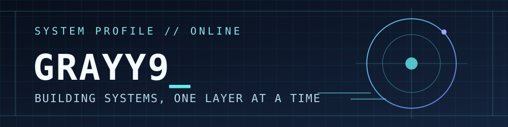

<p align="center">
  
</p>

<p align="center">
  <a href="https://github.com/Grayy9"></a>
  
  
</p>

## `> whoami`

你好，我是 **Grayy9**。目前在学习 **C++ 存储与基础架构**、**Go 后端开发**，也对 **游戏引擎开发** 很感兴趣。

我希望把技术探索落到可运行的项目上：从网络 I/O、连接管理、背压与故障处理开始，再用测试和压测检验设计是否可靠。

## `> current_focus`

```text
[01] C++20 / Linux 网络编程与高性能后端
[02] 存储引擎与系统基础架构
[03] Go 后端服务
[04] 游戏引擎与游戏服务端
```

## `> projects`

| 项目 | 说明 |
| --- | --- |
| [Pulse Monitor](https://github.com/Grayy9/pulse-monitor) | 用 Python 实现的网站可用性监控，包含定时检查、历史记录、报表和 Webhook 告警。 |

<!-- GameEdge 发布为公开仓库并通过 Linux CI 后，在这里添加项目链接和实测结果。 -->

## `> activity`

<details>
  <summary>展开 GitHub 活动统计</summary>
  <p align="center">
    
  </p>
</details>

---

<p align="center"><code>// END OF TRANSMISSION · Thanks for visiting</code></p>
