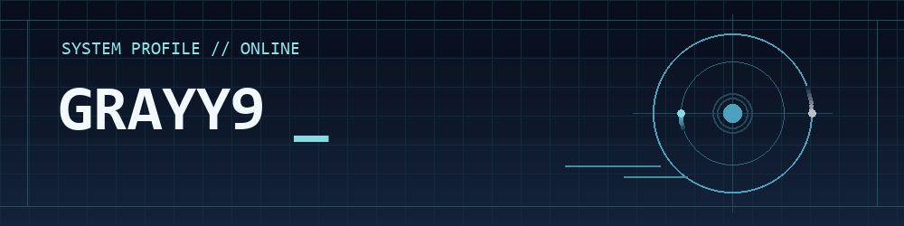

  

  
  
  

## `> whoami`

你好，我是 **Grayy9**，目前在学习 **C++ 高性能后端、存储引擎与基础架构**，同时实践 **Go 后端开发**，也对 **游戏引擎开发** 感兴趣。

## `> current_focus`

| 方向 | 技术重点 | 已完成的实践 |
| --- | --- | --- |
| **01 · 网络编程** | C++20 · Linux / epoll · TCP | [GameEdge](https://github.com/Grayy9/game-edge)：实现流式分帧、慢客户端背压和静态房间路由。 |
| **02 · 存储系统** | WAL · SST · 批量写入 · 压实 | [CoreKV](https://github.com/Grayy9/corekv)：实现日志重放恢复、范围扫描与手动／自动压实。 |
| **03 · 后端服务** | Go · HTTP API · 服务端结算 | [仙途](#project-xiantu)：实现挂机资源与离线收益结算、角色状态保存和玩家交易。 |
| **04 · 游戏技术** | 游戏服务端 · 游戏引擎学习 | 以 GameEdge 和仙途实践连接路由与自动战斗。 |

## `> projects`

### [GameEdge](https://github.com/Grayy9/game-edge) · 游戏服务长连接网关

`C++20` · `epoll / WSAPoll` · `TCP`

面向游戏房间服务的网关实验：实现流式分帧、心跳、连接超时、写缓冲区限制与背压，并支持静态多房间路由、上游故障隔离和优雅退出。

配套压测脚本记录吞吐与 P50 / P99 往返延迟，用来观察不同负载下的行为。

### [CoreKV](https://github.com/Grayy9/corekv) · 嵌入式 KV 存储引擎

`C++20` · `WAL` · `SST` · `WriteBatch`

实现读写、删除、批量写入、范围扫描、刷盘及手动／自动压实。通过 WAL 校验与重放处理恢复，使用删除标记避免旧值复活。

围绕跨重启读写、批次恢复、截断日志和校验失败编写测试，持续完善存储路径。

### 仙途 · 挂机类MMO

`Go` · `JavaScript` · `HTTP API` · `水墨国风`

浏览器可玩的放置游戏原型：包含采集生产、装备与补给、自动战斗、离线结算、行动队列和同服务玩家交易。采药支持七处地点、28味灵药，以及定向采集和区域群采。

服务端负责资源与结算，前端展示实际收获；用这个项目练习完整玩法的数据流、状态一致性与交互。

  
其他实践

- [Pulse Monitor](https://github.com/Grayy9/pulse-monitor)：Python 网站可用性监控，包含定时检查、历史记录、报表与 Webhook 告警。

## `> contact`

欢迎通过公开项目的 Issues 交流实现、测试和改进想法。

---

<code>// END OF TRANSMISSION · Still learning, still building.</code>

